  

# Abdul Rehman
### Software Developer — Python • Linux • Applied AI • Modern C++

> Writing deterministic backend automation, self-hosted Linux infrastructure, and computer vision pipelines. Focused on minimal surface area, reproducible environments, and zero telemetry.

  

---

### 📦 Flagship Projects

#### [📖 Arabic & Urdu Vision OCR Pipeline](https://github.com/arehman-dev)
> **Python • Gemini Vision API • Poppler • ThreadPoolExecutor**  
> Multithreaded CLI pipeline digitizing 779+ pages of classical grammar textbooks with **100% preservation of Arabic vocalization marks (Tashkeel)** and Urdu Nastaliq ligatures into structured Markdown tables.

#### [🏠 Debian Linux Home Server](https://github.com/arehman-dev)
> **Debian 12 Netinst • Docker Compose • WireGuard • Nginx Reverse Proxy**  
> Hardened self-hosted node running containerized network DNS sinkholes, encrypted remote access, and automated cron backup routines with zero host dependencies.

#### [🌐 Virtual Network Testing Sandbox](https://github.com/arehman-dev)
> **Linux Kernel • `ip netns` • `veth` Pairs • QEMU/KVM**  
> Disposable multi-node network simulation environment constructed using Linux network namespaces and virtual ethernet pairs to test routing automations safely without host risk.

---

### 📝 Engineering Articles

| Article | Track | Read Time |
| :--- | :--- | :--- |
| **[Architecting a Resilient Debian Linux Home Server](https://arehman-dev.github.io/articles/architecting-linux-home-server-docker-storage-vpn)** | SysAdmin & Infra | `12 min` |
| **[Building a Multimodal OCR Pipeline in Python for Arabic & Urdu](https://arehman-dev.github.io/articles/multimodal-ocr-pipeline-python-arabic-urdu)** | Applied AI / Vision | `11 min` |
| **[Isolating Linux Network Topologies with `ip netns` and `veth` Pairs](https://arehman-dev.github.io/articles/isolating-linux-network-topologies-ip-netns)** | Linux Kernel Net | `10 min` |

---

### 📡 Coordinates

  <a href="https://arehman-dev.github.io"><b>Portfolio</b></a> &nbsp;•&nbsp;
  <a href="https://www.linkedin.com/in/arehman-dev"><b>LinkedIn</b></a> &nbsp;•&nbsp;
  <a href="mailto:arehman.dev@proton.me"><b>ProtonMail</b></a>

